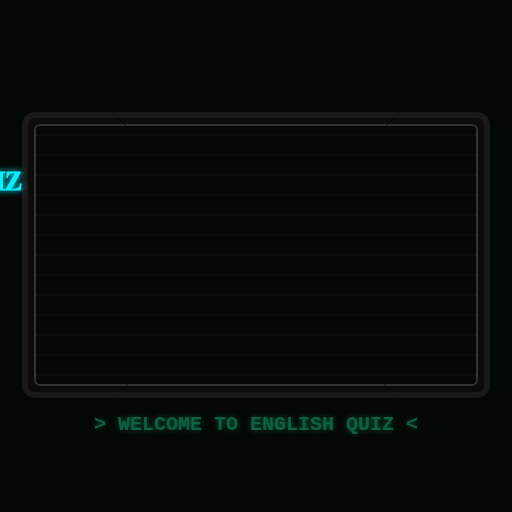

# 🎯 English Quiz Bot Guide

This bot is perfect for Telegram Groups. It contains all the updated commands (100% Pure English).

## 🛡️ GROUP ADMIN COMMANDS
- `Quiz@on` / `Quiz@off` : Start or stop the live quiz.
- `Speed@5s` (or 10s, 1m) : Set the timer speed for the group.
- `Skip@` : Skip the current question.
- `Hint@` : Get a hint for the current question.
- `GroupStats@` : View total players and points in the group.
- `Yes@on` (Reply/Tag) : Grant quiz control permissions to a user.
- `No@off` (Reply/Tag) : Remove quiz control permissions.
- `SetWelcome@` / `RemoveWelcome@` : Set custom welcome message (Supports variables like `{name}`, `{date}`, and media).
- `ScheduleQuiz@18:00` : Auto-start quiz at a specific time daily.
- `ScheduleQuiz@off` : Disable auto-quiz schedule.
- `SetLimit@20` : Set maximum questions per quiz.
- `SetLimit@off` : Remove question limit.
- `AutoDelete@on` : Delete old question messages automatically.
- `AutoDelete@off` : Disable auto-delete.

## 👤 ALL USERS COMMANDS
- `Score@group` : View the group's top 10 leaderboard.
- `Score@all` : View the global top 10 leaderboard.
- `Rank@me` : View your global rank.
- `top@fast` : View the Top 10 fastest answer givers.
- `help@` : View this commands guide.
- `Report@` : Report a wrong question to the owner.

## 👑 BOT OWNER COMMANDS (Only for the Owner)
- `.on` / `.off` : Globally turn the bot on/off.
- `Top10Details@` : View top 10 users with their ID, Name, and Group.
- `UserInfo@` : (Reply) View detailed info of any user.
- `ForceJoin@channel_link` : Set a compulsory channel to join.
- `RemoveForceJoin@` : Remove the force join channel.
- `BroadcastAll@msg` : Send a message to all users and groups.
- `ListGroups@` : View all groups where the bot is added.
- `Stats@users` / `Stats@groups` : View total users and groups.
- `Reset@all` / `Reset@group` : Reset the leaderboard (Deletes points).
- `AddQ@category@Question@Answer` : Add a custom question.
- `DelQ@category@Question` : Delete a custom question.
- `Ban@` / `Unban@` / `Mute@` / `Unmute@` : (Reply/Tag) Control users.
- `DelGroupScore@<Group_ID>` : Delete all scores for a specific group.
- `DelUserScore@` : Show Top 100 users. Then use `delscore@<number>` to delete a specific user's score.
- `DelTopFast@` : Show Top 20 fastest users. Then use `deltop@<number>` to remove a user from the fastest list.

## 🏆 POINT SYSTEM
- **Normal Groups:**
  - Answer within 10 seconds = 100 Points
  - Answer within 20 seconds = 50 Points
  - Answer after 20 seconds = 20 Points
- **VIP Group (Secret):**
  - Answer within 5 seconds = 5240 Points
  - Answer within 10 seconds = 3430 Points
  - Answer after 10 seconds = 1050 Points
